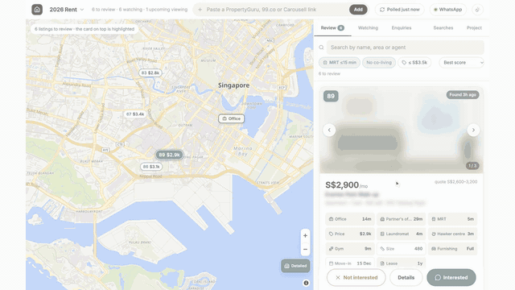
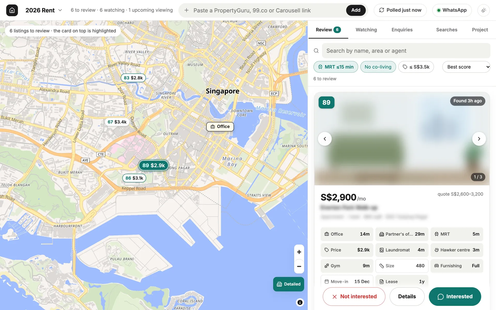
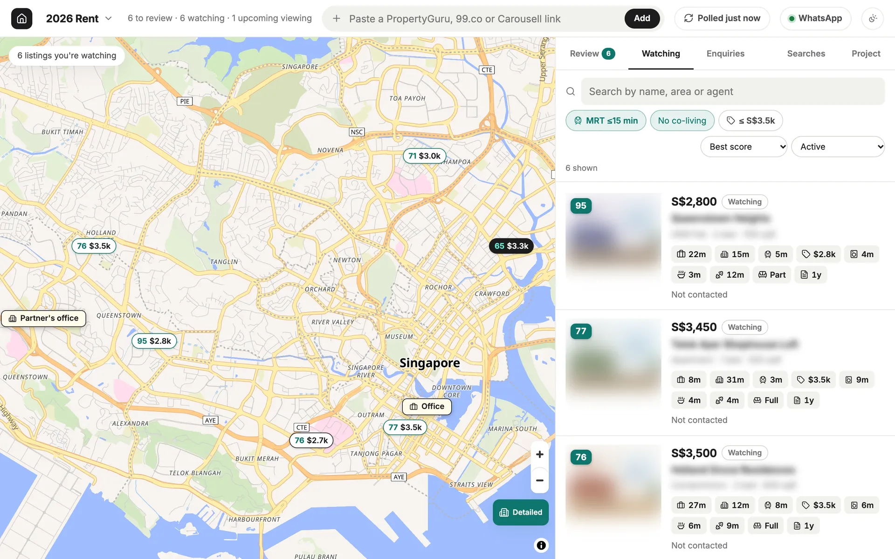
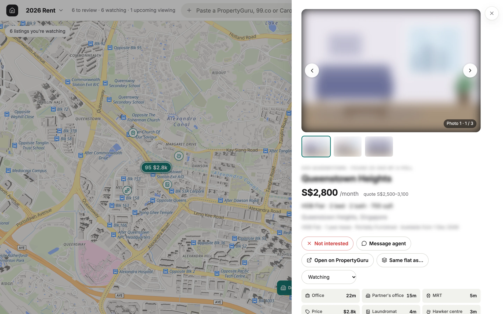
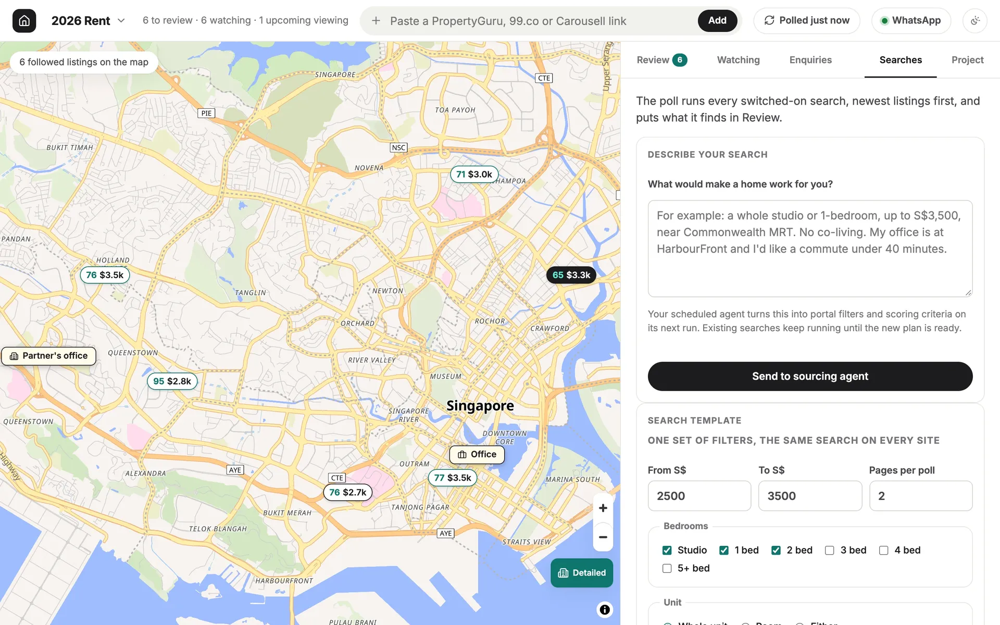
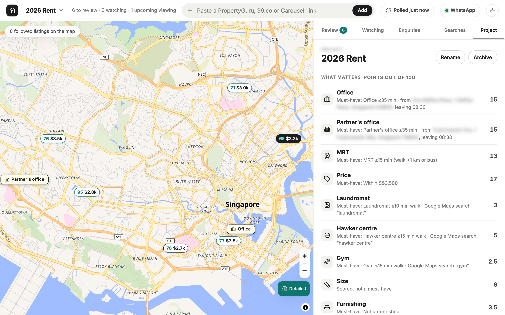
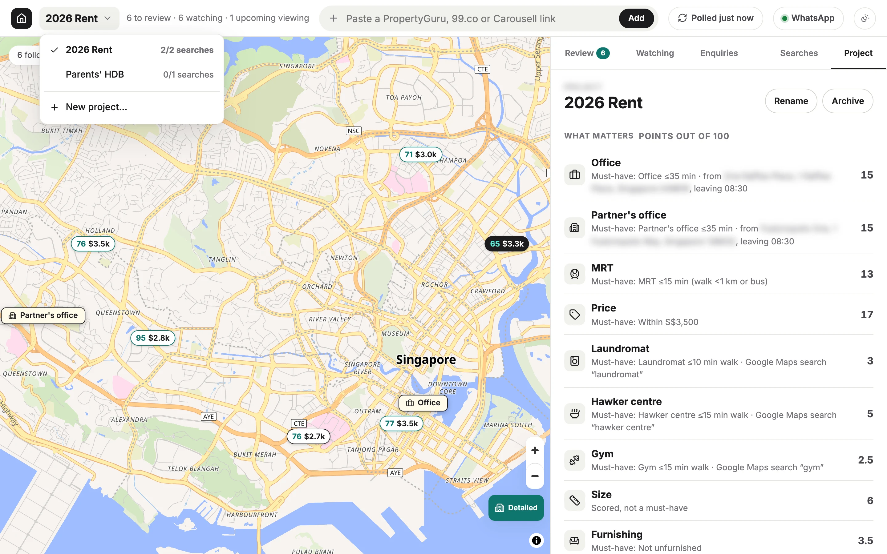
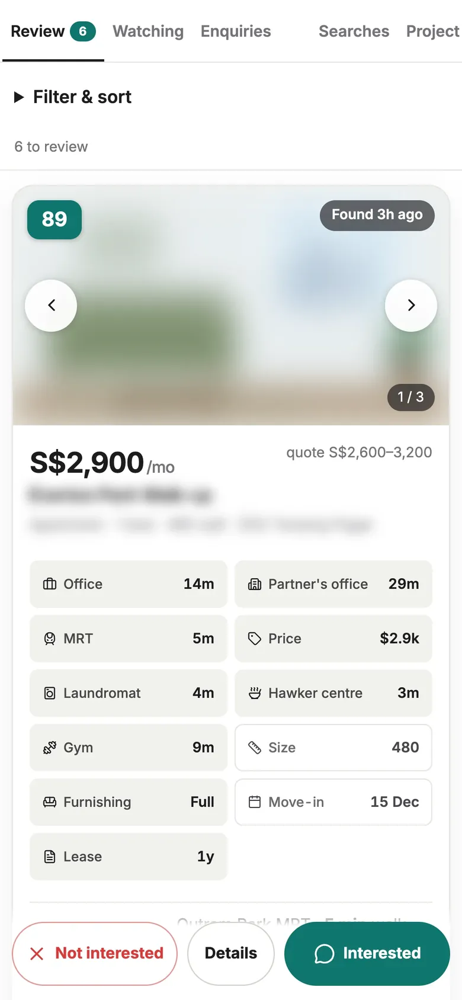

# sg-stay-where

**A home-search tracker for Singapore, for renting or buying. Your coding agent sets it up and runs it.**

It scores new PropertyGuru, 99.co and Carousell listings against your criteria,
such as the commute to work at 08:30, an MRT within 15 minutes, or a hawker
centre and a gym nearby. Each criterion is an icon on the listing card. It also
tracks your WhatsApp chats with property agents.

The problems it solves:

1. The sites' filters stop at price, rooms and area. They can't filter by commute
   time, MRT walk or nearby places.
2. New listings appear on three sites, and you have to check each one.
3. You type the same introduction to every agent.
4. Chats with many agents are hard to keep track of.



<sub>[Full 35-second demo (MP4)](docs/media/demo.mp4) · demo data, listing details blurred</sub>

> [!WARNING]
> **Personal tool, unofficial integrations.** Not affiliated with PropertyGuru,
> 99.co, Carousell, Google or WhatsApp/Meta. Read
> [Risks and responsible use](#risks-and-responsible-use) first.
>
> - **Polls are limited.** One tab, 2 result pages per search by default, at most
>   every 2 hours, no parallel tabs. A poll stops at any CAPTCHA or "are you
>   human" page and never works around it. The sites' terms limit automated
>   access. Personal use only.
> - **WhatsApp is optional and uses [Baileys](https://github.com/WhiskeySockets/Baileys),
>   an unofficial client.** Read Baileys' notes before linking. Don't use it to
>   send bulk or automated messages. Baileys runs only after you run
>   `npm run whatsapp`. Without it, the message dialog still has Copy message and
>   Open in WhatsApp (your own app).

## Features

- **Setup interview.** Your agent asks about budget, home type, the places you go
  to and your must-haves, and saves them as a project. Each listing gets a 0–100
  score and one icon per criterion.
- **Listing search.** Your saved PropertyGuru, 99.co and Carousell searches run
  in your own Chrome every 2 hours once scheduled, or on Poll now. You can
  switch each search on and off.
- **Google Maps checks.** Transit time to each place you commute to, at your
  departure time; walking time to the MRT, or the bus; and the nearest gym,
  hawker centre, laundromat or other place you chose.
- **Review deck.** New listings wait in a deck. Swipe right to see the message to
  the agent for that listing (your details, a budget range around its price, the
  listing link). Edit it, then send it from your linked WhatsApp, open it in your
  own WhatsApp, copy it, or only watch the listing. Nothing is sent until you
  click Send. Swipe left to hide a listing; the same flat from other agents is
  hidden with it.
- **Chat tracking** (optional, recommended). WhatsApp is linked as a device, and
  only chats that started with a listing link are stored. Statuses update from
  the chat (contacted, replied, viewing set, viewed). Each poll, your agent reads
  new messages and writes one summary per home: what was agreed, the viewing time
  and place, and the next step ("Wait for the owner's answer, expected by Fri").
  A refusal or "it's taken" closes the enquiry, with the message as evidence. It
  never sends messages by itself (see [Sending messages](#sending-messages)).
- **Enquiries**: one row per home you're in touch about, with its viewing time,
  latest reply or follow-up, and a "New" mark when something changed. Open it for
  one Latest block (your agent's newest read of the chat and the next step) and the
  chat. A clear refusal closes the enquiry and a cancelled viewing returns it to
  Watching; nothing is deleted, and Watch again undoes it.
- **Watching**: each row shows the home's status. Swipe a row all the way left to
  mark it Not interested (a red trash zone shows first; let go early and nothing
  happens), with Undo in the toast.
- **Projects**: for example "2026 Rent" and "Parents' HDB", each with its own
  criteria, searches and message.
- **Local**: one SQLite file on your machine. Phone access is optional, through
  your own Tailscale network.



| Watching | Listing detail | Searches |
| --- | --- | --- |
|  |  |  |

| Project and criteria | Projects | Phone |
| --- | --- | --- |
|  |  |  |

<sub>Screenshots use the built-in demo data (fictional buildings, agents and
drawn room pictures, `npm run demo`) with blur mode on: open the app with
`?blur=1` to blur photos, names, addresses, agents and chats when you share your
screen.</sub>

## Setup

You need Node.js 22.23.4+ ([Requirements](#requirements)) and
[Claude Code](https://claude.com/claude-code) with
[Claude in Chrome](https://claude.com/chrome), or [Codex](https://github.com/openai/codex)
with the ChatGPT desktop app and its Codex Chrome extension. Browser setup for each:
[docs/polling.md](docs/polling.md#give-the-agent-your-own-chrome).

```sh
git clone https://github.com/aldisf/sg-stay-where.git
cd sg-stay-where
claude --chrome          # or codex
```

Then say:

> **Set up sg-stay-where for me.**

Desktop apps: open the cloned folder as a project in the Claude desktop app
(Claude Code) or the [Codex app](https://developers.openai.com/codex/app) and
send the same line. The desktop apps are not yet tested end to end with this repo.

The agent reads [AGENTS.md](AGENTS.md), installs dependencies, starts the app at
http://127.0.0.1:7431, interviews you
([docs/setup-interview.md](docs/setup-interview.md)), builds your searches on the
sites, writes your project and runs the first poll with you. It asks before linking WhatsApp or scheduling anything.

After setup, polls run every 2 hours if you ask your agent to schedule them, and
when you press **Poll now** in the app's header. They don't need a chat session.

Demo: `npm install && npm run demo && npm run demo:serve`, then open
http://127.0.0.1:7432. It uses fictional data and sends nothing.

## How it works

What each part does, which ones are optional and why it drives your own Chrome:
[docs/architecture.md](docs/architecture.md).


1. **Setup.** The agent interviews you and writes a project file.
2. **Poll** (every 2 hours at most, or "poll now"). Your agent opens each active search in
   your Chrome, hands new listings to the app, opens each new listing for details
   and checks the project's places on Google Maps. A listing appears in Review once
   it's complete.
3. **Review.** You swipe. The app scores, dedupes and maps; WhatsApp chats update the
   status of what you're pursuing; the agent summarises viewings.

### Background jobs

Both run without a chat session. Both need the computer on.

| Job | Schedule | What it does |
| --- | --- | --- |
| **App server** (background service) | Always running | Serves the app. With WhatsApp linked, stores property-chat messages as they arrive and marks replies, viewing times and "may be taken". |
| **Poll** (agent run) | Every 2 hours on the hour, once after waking if one was missed, and on **Poll now** | 1. Summarises new WhatsApp messages, one summary per home. 2. Reads new listings from each search (2 pages). 3. Gets details and Google Maps checks for up to 40 listings. 4. Reopens up to 5 older listings to find removed ones. |

Your agent sets up the schedule with [skills/schedule-polls](skills/schedule-polls/SKILL.md):
a LaunchAgent on macOS, a systemd timer on Linux. Polls start at least 20
minutes apart, including Poll now. The open app checks for changes every 15 seconds.

## Requirements

| | Needed? | Why |
| --- | --- | --- |
| Node.js 22.23.4+ (or 24.22.1+, 26.12.1+) | **Required** | The app (built-in SQLite; no database server). Earlier releases still trust the CAs behind the Oct 2026 eMudhra key compromise; `npm test` checks. |
| A coding agent with browser automation | **Required** for setup and polls | Listing sites block servers, and Google Maps results are only free in a browser ([docs/browser.md](docs/browser.md)). Claude Code with Claude in Chrome, or Codex with the Codex Chrome extension. |
| zsh | **Required** for polls | `scripts/poll.sh` is a zsh script. Built into macOS; on Linux, `apt install zsh` or similar. |
| Google Chrome | **Required** | Pages are loaded in a real Chrome on your computer and connection. |
| A computer that's on | **Required** for polls and chat tracking | Polls, Chrome and the WhatsApp link run on your machine. Asleep or off, nothing is polled; on wake, a missed poll runs once and WhatsApp catches up. |
| WhatsApp on your phone | Optional, **recommended** | Chat tracking, viewing times, taken units, one-click send ([docs/whatsapp.md](docs/whatsapp.md)). Unofficial client; see Baileys' notes. |
| macOS | Optional | `scripts/install-macos.sh` runs the app and the 2-hourly poll as background services. On Linux, a systemd timer. Windows is not supported (polls run a zsh script). |
| Tailscale | Optional | Access from your phone over your private network ([docs/remote-access.md](docs/remote-access.md)). |

Alternatives: if alerts and one commute filter are enough, PropertyGuru alerts and
99.co's travel-time search need no setup.

## Projects and searches

A **project** is one search effort with its own criteria, searches, intro
message and listings. Switch or create projects from the title in the header;
archive finished ones. New projects can copy another's criteria.

A **search** is a titled card holding a PropertyGuru, 99.co or Carousell search
URL (sorted by newest) and how many result pages to read. Switch searches on and
off from the Searches tab; polls run only active ones. For renting, a **search
template** (price, bedrooms, whole unit or room, districts) generates the same
search on all three sites. 99.co and Carousell have no district filter, so
districts are applied from each listing's postal code. Each flat appears once,
however many sites list it (see How matching works).

Instead of writing filters, describe the search in plain language in Searches
(or to your agent) and the agent turns it into portal filters and
scoring criteria on its next run. The tab shows whether the brief is waiting,
applied, or needs more detail. Anything the template can't express (HDB only,
one MRT station) can be added as a search built on the site itself. See
[docs/sourcing.md](docs/sourcing.md).

**Renting or buying.** Each project is one or the other. Buying projects show
whole prices (S$758,000, "$758k" on the map), ask for financing and timeline in
the intro message, and get their searches from the sites' own for-sale filters:
your agent sets them up in your browser
([skills/build-search](skills/build-search/SKILL.md)) instead of the rental
template. Scoring, Google Maps checks, the swipe deck and chat tracking work the
same.

Criteria types (`src/projects.js`): `commute` (transit time to a place, at a set
departure time), `nearby` (walk to the nearest match of a Google Maps search),
`station` (MRT walk or bus), `price`, `size`, `furnishing`, `move_in`, `lease`.
Each has an icon (any [Lucide](https://lucide.dev/icons) icon), a limit for the
must-have check and a weight.

## How matching works

1. **Listing to your criteria.** Each criterion scores 0–1 (a commute at or
   under 20 minutes scores 1, falling to 0 at 50 by default), times its weight.
   Weights fill 100 points minus two bonuses: 10 when every must-have passes,
   5 when the MRT and everyday places add up to a short walk. Unchecked data
   scores half. Each criterion is a chip on the card.
2. **Same flat across sites.** Bedrooms must agree, then either 3+ photos match
   by fingerprint (2 in the same building with a similar size), or same block,
   size within 3% and price within S$100. For sale prices the price gaps are a
   share of the price (1% with photos, 0.2% without). Copies merge into one card
   that links to every advert; hiding a flat hides its repeats. "Not the same
   flat" splits a wrong merge for good.
3. **Chat to listing.** A one-to-one chat counts only if a PropertyGuru or 99.co
   link (or a Carousell link to a tracked listing) is in its first 10 messages,
   and the person isn't in `excludeNames`. It's tied to the listing its link
   points to, the one whose intro you sent, or one you pick in Enquiries. All
   other chats are dropped in memory.

## Sending messages

The tracker reads and summarises chats. It sends a message only when you click
Send, after you've read it. It never replies by itself, because:

1. Property agents handle many enquiries. Automatic replies and timed follow-ups
   add messages without adding information.
2. Rental and sale chats include offers, deposits, lease terms and viewing times.
   A wrong automatic answer can cost money or the flat.
3. The agent expects to talk to you, not to software.
4. Chat text is untrusted. A message could contain instructions aimed at an AI,
   and a tracker that only reads can't act on them.
5. WhatsApp doesn't allow automated or bulk messaging. Sends happen only on your
   click, the same message is never sent twice to one agent, and the poll's API
   client refuses the send route.

Instead, Enquiries shows which chats need a reply, what was said and the next
step. More in [docs/whatsapp.md](docs/whatsapp.md#reading-and-sending).

## Privacy

- Everything is stored in `data/` on your machine (gitignored): the SQLite
  database, project files, screenshots. The WhatsApp session keys are kept
  outside the repo, in `~/.config/sg-stay-where/`.
- The server binds to `127.0.0.1`. Remote access only through an authenticated
  tunnel with an allow-list of accounts.
- WhatsApp: only one-to-one chats that start with a PropertyGuru/99.co link, or a
  Carousell link to a listing the tracker already holds (within
  the first 10 messages) are stored; names you exclude are never read; everything
  else is dropped in memory. This is a programmatic filter in the WhatsApp client and
  the database, not an instruction to the AI: your agent can only read what the
  tracker stored, through routes that serve property chats only. How it works, step
  by step: [docs/whatsapp.md](docs/whatsapp.md#how-the-filter-works-in-code).
  Chat text is treated as untrusted.
- Listing pages are read in your browser; nothing is sent to third parties beyond
  the sites you'd visit anyway (and the OpenFreeMap tile server for the map,
  in both its Simple and Detailed styles).

## Risks and responsible use

**WhatsApp is optional.** Baileys runs only after you run `npm run whatsapp`,
which links your number and sets `"enabled": true` in `data/whatsapp.json`.
Without it, the message dialog has Copy message and Open in WhatsApp, which opens
the chat in your own app with the message filled in.

If you do link it: in Baileys' own words, *"This project is not affiliated,
associated, authorized, endorsed by, or in any way officially connected with
WhatsApp or any of its subsidiaries or its affiliates."* and *"Do not spam people
with this. We discourage any stalkerware, bulk or automated messaging usage."*
WhatsApp's Terms don't allow unofficial clients or bulk and automated messaging;
read [Baileys' README](https://github.com/WhiskeySockets/Baileys#disclaimer) for
what that means for you. This tool reads property chats and sends **only** what
you click, and never the same message twice to one agent. The poll's API
client refuses the send route; Claude Code's poll can use nothing else, while
Codex has a full shell and keeps to it by instruction
([details](docs/polling.md#scheduling)).
Write to an agent only about their listing, and don't send to many listings in a
row. To keep all sending on your phone, send from there and link WhatsApp only
for tracking.
Details: [docs/whatsapp.md](docs/whatsapp.md).

**Listing sites and poll limits.** PropertyGuru, 99.co and Carousell content
belongs to them and their agents. Their terms limit automated access, and they
use bot protection (Cloudflare). Many page loads from one browser trigger a
"verify you're human" page, and repeated ones can block you for a while. Poll limits:

1. **Interval.** Every 2 hours by default, and at least 20 minutes after the last
   poll started, including Poll now.
2. **Size.** 2 result pages per search by default (up to 5), one tab, a few
   seconds between pages.
3. **Bot checks.** A poll waits up to 30 s for a Cloudflare page to clear by
   itself, otherwise skips that site until the next poll. It never clicks through
   a check or works around a block.
4. **Listing pages.** Each poll opens up to 40 listings for their details (150
   if you set it) and rechecks up to 5 older ones. Google Maps checks don't load
   the listing sites.

Use it for your own home search only. Don't run it as a service, republish
listings or increase the limits.

**Google Maps.** A few lookups per listing in your browser. Google's terms forbid
bulk extraction; keep it personal.

You are responsible for how you use this. If any of the above is a problem, leave
the optional parts off.

## Uninstall

Ask your agent to remove sg-stay-where. It follows
[skills/uninstall](skills/uninstall/SKILL.md) and asks before each deletion.

## Development

```sh
npm install
npm test                         # unit and HTTP asset tests (node:test)
npx playwright install chromium webkit
npm run test:e2e                  # desktop Chromium, Android and iPhone WebKit profiles
npm run test:e2e:ui               # interactive runner
npm run demo && npm run demo:serve
```

Browser tests start a fresh server and fictional database for each test on ports
17432 onward. They never use `data/`, the live server, or a real WhatsApp session.
They run the real frontend, API, SQLite and MapLibre renderer. Third-party tiles,
fonts and embeds are replaced with local responses for repeatability. Failure
screenshots and traces are in `test-results/`; open the report with
`npx playwright show-report`. See [browser testing](docs/testing.md) for coverage
and the real-phone checks.

Code map and agent rules: [AGENTS.md](AGENTS.md). Design system: [DESIGN.md](DESIGN.md).

Built on [Baileys](https://github.com/WhiskeySockets/Baileys) (MIT),
[MapLibre GL JS](https://maplibre.org) (BSD-3) with
[OpenFreeMap](https://openfreemap.org) tiles (© OpenMapTiles, data ©
OpenStreetMap contributors), and [Lucide](https://lucide.dev) icons (ISC).

## License

[MIT](LICENSE)
