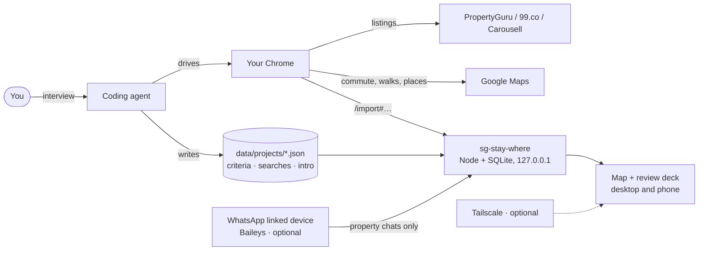

# sg-stay-where

**A home-hunting tracker for Singapore, to rent or to buy, that your coding agent sets up for you.**
Tell it what matters — the commute to work at 8:30, an MRT within 15 minutes, a
hawker centre and a gym nearby — and it scores every new PropertyGuru, 99.co and
Carousell
listing against that, shows each criterion as an icon on the card, and keeps
track of your WhatsApp conversations with agents.

Why: the sites' filters can't express your own criteria (a commute, an MRT walk,
a hawker centre nearby); checking three sites for new listings is a chore; every
agent gets the same intro retyped; and the chats are hard to keep track of. This
scores listings your way, finds new ones for you, writes the intro per listing,
and shows which conversations need your attention.


<sub>[Full 35-second demo (MP4)](docs/media/demo.mp4) · demo data, listing details blurred</sub>

> [!WARNING]
> **Personal tool, unofficial integrations.** Not affiliated with PropertyGuru,
> 99.co, Carousell, Google or WhatsApp/Meta. Read
> [Risks and responsible use](#risks-and-responsible-use) first.
>
> - **Polls must look like a person browsing.** One tab, 2 result pages per
>   search by default, every 2 hours at most, no parallel tabs. At any CAPTCHA
>   or "are you human" page, stop; never work around it. The sites' terms limit
>   automated access. Personal use only.
> - **WhatsApp is optional and uses [Baileys](https://github.com/WhiskeySockets/Baileys),
>   an unofficial client.** Read Baileys' own notes before linking, and use it
>   the way you'd use your phone: don't spam, respect people's time. You can
>   skip it: nothing Baileys-related runs unless you run `npm run whatsapp`,
>   which turns it on. Without it, the intro dialog still has Copy message and Open in
>   WhatsApp (your own app).

## What it does

- **Interviews you** (through your agent) about budget, home type, the places
  that matter and what's a must-have, and turns it into a project: a 0–100 score
  and one icon per criterion on every card.
- **Finds listings** by running your saved PropertyGuru, 99.co and Carousell searches in *your
  own* Chrome every couple of hours. Searches are cards you switch on and off.
- **Measures what matters on Google Maps**: transit time to each place you commute
  to at the time you actually leave, walking time to the MRT (or the bus), and the
  nearest gym, hawker centre, laundromat — whatever you chose.
- **Swipe right to message the agent**: new listings wait in a swipe deck. Swipe
  right and you see your intro message for that listing (your details, a budget
  range around its price, the listing link). Edit it, then send it from your
  linked WhatsApp, open it in your own WhatsApp, copy it to paste into the
  site's chat, or just watch the listing.
  Nothing is sent without that click. Swipe left if not interested; the same
  flat posted by five agents is hidden together.
- **Tracks and summarises your chats with agents** (optional, recommended): links
  WhatsApp as a linked device and reads *only* chats that began with a listing
  link. Statuses move by themselves (contacted → replied → viewing set → viewed),
  and on each run your coding agent reads the new messages and writes one short
  state per home: what was agreed, the viewing time and place, and what happens
  next ("Wait for the owner's answer, expected by Fri"). A refusal or "it's taken"
  closes the enquiry, backed by the message that said so. It never replies for
  you: see [why](#why-it-never-replies-for-you).
- **Enquiries**: one row per home you're in touch about, with its viewing time,
  latest reply or follow-up, and a "New" mark when something changed. Open it for
  one Latest block (your agent's newest read of the chat and the next step) and the
  chat. A clear refusal closes the enquiry and a cancelled viewing returns it to
  Watching; nothing is deleted, and Watch again undoes it.
- **Watching**: each row shows the home's status. Swipe a row all the way left to
  mark it Not interested (a red trash zone shows first; let go early and nothing
  happens), with Undo in the toast.
- **Projects**: "2026 Rent", "Parents' HDB" — each with its own criteria, searches
  and intro message.
- **Local**: one SQLite file on your machine. Phone access is optional, through
  your own Tailscale network.


| Watching | Listing detail | Searches |
| --- | --- | --- |
|  |  |  |

| Project and criteria | Projects | Phone |
| --- | --- | --- |
|  |  |  |

<sub>Screenshots use the built-in demo data (fictional buildings, agents and
drawn room pictures, `npm run demo`) with blur mode on: open the app with
`?blur=1` to blur photos, names, addresses, agents and chats when you share your
screen.</sub>

## Get started: point your agent at it

You need [Claude Code](https://claude.com/claude-code) with
[Claude in Chrome](https://claude.com/chrome), or [Codex](https://github.com/openai/codex)
with the Codex Chrome extension. Browser setup for each:
[docs/polling.md](docs/polling.md#give-the-agent-your-own-chrome).

```sh
git clone https://github.com/aldisf/sg-stay-where.git
cd sg-stay-where
claude --chrome          # or codex
```

Then say:

> **Set up sg-stay-where for me.**

Rather not use a terminal? Open the cloned folder as a project in the Claude
desktop app (Claude Code) or the [Codex app](https://developers.openai.com/codex/app)
and send the same line. Same runbook; the desktop apps are not yet tested end
to end with this repo.

The agent reads [AGENTS.md](AGENTS.md), installs dependencies, starts the app at
http://127.0.0.1:7431, interviews you
([docs/setup-interview.md](docs/setup-interview.md)), builds your searches on the
sites, writes your project and runs the first poll with you. It asks before linking WhatsApp or scheduling anything.

After setup, polls run every 2 hours on their own if you ask your agent to
schedule them, or whenever you press **Poll now** in the app's header. Neither
needs a chat open.

Just looking? `npm install && npm run demo && npm run demo:serve`, then open
http://127.0.0.1:7432 (fictional data, nothing leaves your machine).

## How it works

What each part does, which ones are optional and why it drives your own Chrome:
[docs/architecture.md](docs/architecture.md).



1. **Setup.** The agent interviews you and writes a project file.
2. **Poll** (every 2 hours at most, or "poll now"). Your agent opens each active search in
   your Chrome, hands new listings to the app, opens each new listing for details
   and checks the project's places on Google Maps. A listing appears in Review once
   it's complete.
3. **Review.** You swipe. The app scores, dedupes and maps; WhatsApp chats update the
   status of what you're pursuing; the agent summarises viewings.

## Requirements

| | Needed? | Why |
| --- | --- | --- |
| Node.js 22.23.4+ (or 24.22.1+, 26.12.1+) | **Required** | The app (built-in SQLite; no database server). Earlier releases still trust the CAs behind the Oct 2026 eMudhra key compromise; `npm test` checks. |
| A coding agent with browser automation | **Required** for setup and polls | Listing sites block servers, and Google Maps answers are only free in a browser — [docs/browser.md](docs/browser.md). Claude Code with Claude in Chrome, or Codex with the Codex Chrome extension. |
| Google Chrome | **Required** | Your signed-in browser does the fetching. |
| A computer that's on | **Required** for polls and chat tracking | Polls, Chrome and the WhatsApp link run on your machine. Asleep or off, nothing is polled; on wake, a missed poll runs once and WhatsApp catches up. |
| WhatsApp on your phone | Optional, **recommended** | Lead tracking, viewing times, taken units, one-click intro — [docs/whatsapp.md](docs/whatsapp.md). Unofficial client; see Baileys' notes. |
| macOS | Optional | `scripts/install-macos.sh` runs the app and the 2-hourly poll as background services. On Linux use cron/systemd; on Windows run it by hand. |
| Tailscale | Optional | Use it from your phone, privately — [docs/remote-access.md](docs/remote-access.md). |

Who it isn't for: if alerts and a commute filter are enough, PropertyGuru alerts
plus 99.co's travel-time search need no setup at all.

## Projects and searches

A **project** is one search effort with its own criteria, searches, intro
message and listings. Switch or create projects from the title in the header;
archive finished ones. New projects can copy another's criteria.

A **search** is a titled card holding a PropertyGuru, 99.co or Carousell search
URL (sorted by newest) and how many result pages to read. Switch searches on and
off from the Searches tab; polls run only active ones. For renting, a **search
template** (price, bedrooms, whole unit or room, districts) generates the same
search on all three sites. 99.co and Carousell have no district filter, so
districts are applied from each listing's postal code. Each flat appears once,
however many sites list it (see How matching works).

Instead of writing filters, describe the search in plain language in Searches
(or to your agent) and the agent turns it into portal filters and
scoring criteria on its next run. The tab shows whether the brief is waiting,
applied, or needs more detail. Anything the template can't express (HDB only,
one MRT station) can be added as a search built on the site itself. See
[docs/sourcing.md](docs/sourcing.md).

**Renting or buying.** Each project is one or the other. Buying projects show
whole prices (S$758,000, "$758k" on the map), ask for financing and timeline in
the intro message, and get their searches from the sites' own for-sale filters:
your agent sets them up in your browser
([skills/build-search](skills/build-search/SKILL.md)) instead of the rental
template. Scoring, Google Maps checks, the swipe deck and chat tracking work the
same.

Criteria types (`src/projects.js`): `commute` (transit time to a place, at a set
departure time), `nearby` (walk to the nearest match of a Google Maps search),
`station` (MRT walk or bus), `price`, `size`, `furnishing`, `move_in`, `lease`.
Each has an icon (any [Lucide](https://lucide.dev/icons) icon), a limit for the
must-have check and a weight.

## How matching works

1. **Listing to your criteria.** Each criterion scores 0–1 (a commute at or
   under 20 minutes scores 1, falling to 0 at 50 by default), times its weight.
   Weights fill 100 points minus two bonuses: 10 when every must-have passes,
   5 when the MRT and everyday places add up to a short walk. Unchecked data
   scores half. Each criterion is a chip on the card.
2. **Same flat across sites.** Bedrooms must agree, then either 3+ photos match
   by fingerprint (2 in the same building with a similar size), or same block,
   size within 3% and price within S$100. For sale prices the price gaps are a
   share of the price (1% with photos, 0.2% without). Copies merge into one card
   that links to every advert; hiding a flat hides its repeats. "Not the same
   flat" splits a wrong merge for good.
3. **Chat to listing.** A one-to-one chat counts only if a PropertyGuru or 99.co
   link (or a Carousell link to a tracked listing) is in its first 10 messages,
   and the person isn't in `excludeNames`. It's tied to the listing its link
   points to, the one whose intro you sent, or one you pick in Enquiries. All
   other chats are dropped in memory.

## Why it never replies for you

The tracker reads and summarises; every message you send is one you chose and
read first.

- **Not spammy, respectful of people's time.** An agent on the other end is a
  person juggling dozens of enquiries. A bot that answers instantly, follows up
  on a timer or messages every listing produces volume, not conversations. One
  considered message from you gets a better answer than five automatic ones.
- **Real commitments.** Rental chats are offers, deposits, lease terms and
  viewing times. A wrong automatic "yes" costs money or a flat.
- **Honesty.** The agent thinks they are talking to you. They didn't agree to
  negotiate with software.
- **Chat text is untrusted.** A message could contain instructions aimed at an
  AI; a tracker that only reads can't be talked into sending anything.
- **WhatsApp's rules.** WhatsApp doesn't allow automated or bulk messaging.
  Sends here are your clicks only, never the same message twice to one agent,
  and the poll's API client refuses the send route.

What it does instead: tells you who is waiting on you (Enquiries → Needs your
attention), what was said and what's next, so replying takes you a minute. More
in [docs/whatsapp.md](docs/whatsapp.md#read-and-summarise-never-reply).

## Privacy

- Everything is stored in `data/` on your machine (gitignored): the SQLite
  database, project files, screenshots, the WhatsApp session.
- The server binds to `127.0.0.1`. Remote access only through an authenticated
  tunnel with an allow-list of accounts.
- WhatsApp: only one-to-one chats that start with a PropertyGuru/99.co link, or a
  Carousell link to a listing the tracker already holds (within
  the first 10 messages) are stored; names you exclude are never read; everything
  else is dropped in memory. This is a programmatic filter in the WhatsApp client and
  the database, not an instruction to the AI: your agent can only read what the
  tracker stored, through routes that serve property chats only. How it works, step
  by step: [docs/whatsapp.md](docs/whatsapp.md#how-the-filter-works-in-code).
  Chat text is treated as untrusted.
- Listing pages are read in your browser; nothing is sent to third parties beyond
  the sites you'd visit anyway (and the OpenFreeMap tile server for the map,
  in both its Simple and Detailed styles).

## Risks and responsible use

**WhatsApp is optional.** You can skip it entirely. Nothing Baileys-related
runs unless you run `npm run whatsapp`, which links your number and sets
`"enabled": true` in `data/whatsapp.json`. Without it, the intro dialog still
has Copy message and Open in WhatsApp, which opens the chat in your own app with
the message filled in; you press send there.

If you do link it: in Baileys' own words, *"This project is not affiliated,
associated, authorized, endorsed by, or in any way officially connected with
WhatsApp or any of its subsidiaries or its affiliates."* and *"Do not spam people
with this. We discourage any stalkerware, bulk or automated messaging usage."*
WhatsApp's Terms don't allow unofficial clients or bulk and automated messaging;
read [Baileys' README](https://github.com/WhiskeySockets/Baileys#disclaimer) for
what that means for you. This tool reads property chats and sends **only** what
you click, and never the same message twice to one agent. The poll's API
client refuses the send route; Claude Code's poll can use nothing else, while
Codex has a full shell and keeps to it by instruction
([details](docs/polling.md#scheduling)).
Use it like a person, not a bot: don't spam, respect people's time, and write to
an agent only about their listing. Don't loop over listings.
If you'd rather keep sending human-only, send intros from your phone and use the
link only for tracking.
Details: [docs/whatsapp.md](docs/whatsapp.md).

**Listing sites: why polls are throttled.** PropertyGuru, 99.co and Carousell
content belongs to them and their agents, their terms limit automated access,
and they run bot protection (Cloudflare). A burst of page loads from one browser
gets a "verify you're human" page, and repeated ones can block you for a while.
So a poll behaves like a person browsing:

1. **Spaced out.** Every 2 hours by default, and never less than 20 minutes after
   the last poll started, including Poll now.
2. **Small.** 2 result pages per search by default (up to 5), one tab, a few
   seconds between pages, no parallel tabs.
3. **Polite at a check.** It waits for a Cloudflare page to clear by itself (up
   to 30 s) and otherwise skips that site until the next poll. It never clicks
   through a check or works around a block.
4. **Generous where it's safe.** Google Maps checks don't load the listing
   sites, so each poll finishes up to 40 listings (150 if you set it).

Scheduled polls run with nobody watching, so they keep to these limits most
strictly. Use it for your own home search only: don't run it as a service,
republish listings or crawl harder.

**Google Maps.** A few lookups per listing in your browser. Google's terms forbid
bulk extraction; keep it personal.

You are responsible for how you use this. If any of the above is a problem for
you, leave the optional parts off.

## Removing it

Ask your agent to remove sg-stay-where. It follows
[skills/uninstall](skills/uninstall/SKILL.md) and asks before each deletion.

## Development

```sh
npm install
npm test                         # unit and HTTP asset tests (node:test)
npx playwright install chromium webkit
npm run test:e2e                  # desktop Chromium, Android and iPhone WebKit profiles
npm run test:e2e:ui               # interactive runner
npm run demo && npm run demo:serve
```

Browser tests start a fresh server and fictional database for each test on ports
17432 onward. They never use `data/`, the live server, or a real WhatsApp session.
They run the real frontend, API, SQLite and MapLibre renderer. Third-party tiles,
fonts and embeds are replaced with local responses for repeatability. Failure
screenshots and traces are in `test-results/`; open the report with
`npx playwright show-report`. See [browser testing](docs/testing.md) for coverage
and the real-phone checks.

Code map and agent rules: [AGENTS.md](AGENTS.md). Design system: [DESIGN.md](DESIGN.md).

Built on [Baileys](https://github.com/WhiskeySockets/Baileys) (MIT),
[MapLibre GL JS](https://maplibre.org) (BSD-3) with
[OpenFreeMap](https://openfreemap.org) tiles (© OpenMapTiles, data ©
OpenStreetMap contributors), and [Lucide](https://lucide.dev) icons (ISC).

## License

[MIT](LICENSE)
