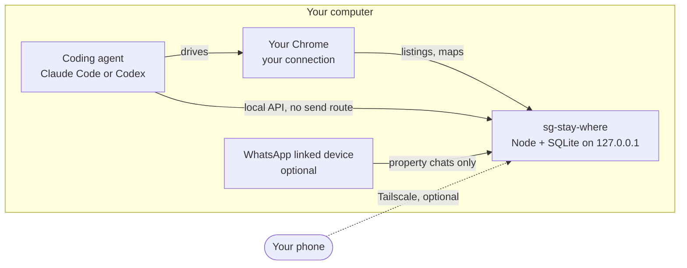

# Components: what runs where, and what you can leave out

sg-stay-where is a small local web app plus a coding agent that does the parts a
server cannot: reading listing sites and Google Maps in your own browser. Only
two pieces are required. Everything else adds something and can be switched off.

| Component | Status | What it does | Without it |
| --- | --- | --- | --- |
| **Node app** (`src/`, `public/`) | Required | Scores, dedupes, maps and stores listings in one SQLite file. Serves the swipe deck on `127.0.0.1:7431`. | Nothing works. |
| **Coding agent with a browser tool** | Required for setup and polls | Interviews you and writes the project. Every poll it opens your searches, hands listings to the app, and checks commutes and nearby places on Google Maps. | You can still paste listing links (header box) and use the bookmarklet by hand. Nothing gets scored on Google Maps. |
| **Google Chrome** | Required | The browser the agent drives. | See "Why your own Chrome" below. |
| **WhatsApp link** (Baileys) | Optional, **recommended** | Tracks the conversation with each agent: contacted, replied, viewing set, taken. Lets Send in the swipe-right dialog go out directly. | Swipe right still works. Open in WhatsApp hands the same message to your own WhatsApp app. Statuses are then yours to set. |
| **Scheduled polls** (`scripts/install-macos.sh`, cron) | Optional | Runs a poll every 2 hours. | Say "poll now" to your agent whenever you like. |
| **Tailscale** | Optional | Opens the app from your phone, privately, on your own tailnet. | Use it on the computer it runs on. |
| **macOS LaunchAgents** | Optional | Keeps the app running in the background and restarts it. | `npm start` in a terminal. |

## Why it uses your Chrome

1. **Listing sites block servers.** PropertyGuru, 99.co and Carousell sit behind Cloudflare.
   A request from a script, a datacenter IP or a headless browser gets a `403` or a
   challenge. Your everyday Chrome, on your home connection, opens the same page
   normally. The tracker never fetches listing pages itself.
2. **Google Maps answers the real questions for free, in a browser.** Transit
   time at 08:30 on a weekday, the walk to the nearest MRT exit, the closest
   hawker centre. The same answers through the Directions and Places APIs need
   an API key and billing, and they differ from what you'd see yourself.
3. **Same load as you browsing.** One tab, two result pages per search per poll by default,
   no proxies, no parallel crawling, no captcha solving. A challenge page clears
   by itself or the search is skipped.
4. **The data stays with you.** Pages are read in your browser. Results reach
   the app through `http://127.0.0.1:7431/import#…`, and the data rides in the
   URL fragment, which never leaves your machine.

### Why page scripts instead of screenshots

Claude in Chrome and the Codex Chrome extension drive a real Chrome on your computer and can run JavaScript in the
page. The extractors (`browser/propertyguru.js`, `browser/99co.js`,
`browser/carousell.js`, `browser/googlemaps.js`) read the structured data a page already carries:
PropertyGuru's `__NEXT_DATA__`, 99.co's JSON-LD and agent block, and Google Maps'
route panel. That makes a poll exact, repeatable and cheap in tokens. A field is
either there or reported missing. The agent does not have to guess from pixels.

Screenshot-driven computer use also works with the same runbook and any browser,
but it is slower and reads numbers off images. Headless browser frameworks
(Playwright, Puppeteer) are what the sites block. They are used here only for
the app's own tests against fictional data.

## Agent access to the app

A poll talks to the app through `node src/cli.js api`, a local client that
refuses the send route. The agent can:

- import listings, attach Google Maps results and screenshots;
- mark a listing page as gone (the server refuses other status changes from a
  poll);
- record evidence-backed follow-ups (a viewing time, a cancellation, an ended
  enquiry) from property chats, with a token that proves it read the latest
  messages.

Through it, the agent cannot send a message, move a listing into Watching or
Not interested, or read a WhatsApp chat that was not stored. Claude Code's
scheduled poll is allowed no other way in. Codex has a full shell and keeps to
this client by instruction (see
[polling.md](polling.md#scheduling)). Sending is a click in the
swipe-right dialog. Review is your swipe. See the hard rules in
[AGENTS.md](../AGENTS.md).

## What WhatsApp stores

The WhatsApp client sees every message your phone syncs, so the filter sits in
code before anything is written:

1. Groups, broadcasts, channels and your own chat are ignored outright.
2. A one-to-one chat is stored only if a PropertyGuru or 99.co listing link
   (or a Carousell link to a listing already tracked; Carousell sells everything)
   appears within its first 10 messages. That is the shape of a chat started
   from a listing's WhatsApp button, or by your intro.
3. People you share listings with (`excludeNames`) are never stored, even with a
   link.
4. Everything else is checked for a link in memory and dropped. Only a count of
   dropped messages is kept.

The agent can only read what was stored, through routes that answer 404 for any
other chat. `npm run privacy` prints what is stored without printing message
text. Details and tests: [docs/whatsapp.md](whatsapp.md#how-the-filter-works-in-code).

## Where things live

| Path | What |
| --- | --- |
| `data/sg-stay-where.sqlite` | Listings, scores, Google Maps results, property chats. |
| `data/projects/<id>.json` | Your criteria, searches, intro message. Written by the setup interview. |
| `~/.config/sg-stay-where/<id>/whatsapp-auth/` | The linked-device session, outside the project on purpose. Treat it like a password. |
| `data/whatsapp.json` | WhatsApp on/off, `excludeNames`, `maxMessagesBeforeLink`. |
| `browser/` | Extractors that run inside the listing sites and Google Maps. |
| `scripts/poll-prompt.md` | What a scheduled poll does, step by step. |

`data/` is gitignored and never leaves your machine.
