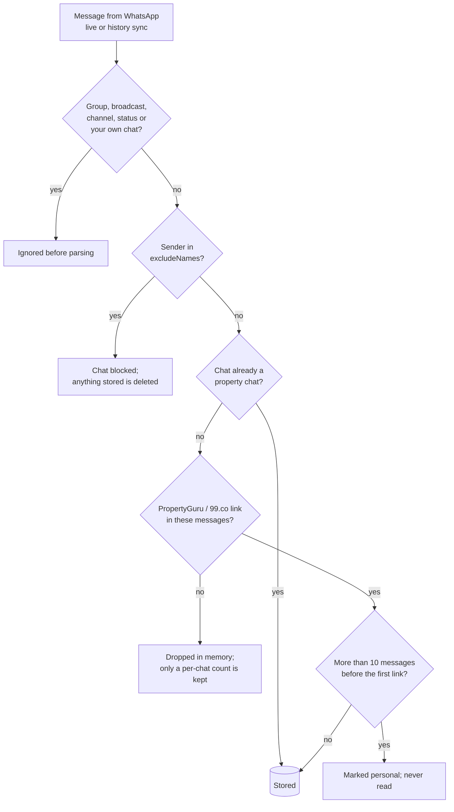

# WhatsApp (optional, recommended)

In Singapore, nearly every rental conversation happens on WhatsApp. Linking it is
optional; everything else works without it. Linked, it adds:

- **Leads update themselves**: contacted, agent replied, waiting for a reply,
  follow-up due.
- **Enquiries**: one row per home you're in touch about, in the Enquiries tab.
  Your agent reads the property chats and fills in the viewing time, place and
  next step; new replies mark that home "New". The scheduled agent
  reviews watched/viewing/viewed conversations before sourcing, with evidence
  for changes, and each home's detail sheet shows its latest state in one block.
- **Enquiries close**: an explicit refusal or ending closes the enquiry; a taken
  unit becomes Taken. A cancelled viewing returns to Watching. Watch again fences
  old evidence, and user-hidden listings stay hidden. Nothing is sent or deleted.
- **One-click intro**: a listing's intro message, with your details and a budget
  range around its price, shown when you swipe right on a listing and sent only
  when you press Send. Without the link, Open in WhatsApp starts the
  chat in your own WhatsApp with the same message.

## Reading and sending

On each run your coding agent reads the property chats that changed since its
last read and writes one state per home through `PUT /api/listings/:id/summary`:
a short summary, the viewing (time, place, confirmed), the next step, and an
outcome when a message settles something (viewing set or cancelled, viewed,
declined, taken). An outcome needs the message that says so as evidence and a
token proving the agent read the latest messages; the server refuses anything
else, never infers closure from silence, and never reopens a home you hid. The
Enquiries tab shows the result as one row per home, and the detail sheet as one
Latest block.

It never writes back, by design:

- **Not spammy, respectful of people's time.** Agents are people handling many
  enquiries at once. Instant auto-replies, timed follow-ups and bulk intros add
  noise to their day and make every renter look like a bot. A tracker that tells
  *you* who is waiting and what was said lets you send one good message instead.
- **Messages carry commitments**: offers, deposits, lease terms, viewing times.
  A wrong automatic answer is expensive and hard to take back.
- **The other side never agreed to talk to software.**
- **Chat text is untrusted input.** Something in a message could be written to
  steer an AI. Reading-only means no message can make the tracker send one.
- **Your number.** WhatsApp bans unofficial clients that message automatically.
  The only send path is your click in the app, never the same message twice to one agent;
  `node src/cli.js api`, which polls use, refuses the send route.

## How it works

The server links to your WhatsApp as a **linked device** (like WhatsApp Web)
through [Baileys](https://github.com/WhiskeySockets/Baileys), an open-source,
unofficial WhatsApp Web client. Your phone stays the main device.

Privacy filter (`src/whatsapp.js`):

- Only **one-to-one** chats are considered; groups, broadcasts, channels and
  status updates are ignored.
- A chat is stored only if a PropertyGuru or 99.co link, or a Carousell link to a
  listing the tracker already holds, appears **within its first
  10 messages** (`maxMessagesBeforeLink`). That is a conversation that started
  about a listing. A friend who once forwards a link is not one.
- Names in `data/whatsapp.json` `excludeNames` are never read, even with a link —
  put the people you share listings with there (partner, family).
- Every other message is checked for a link in memory and dropped. Nothing else
  is written to disk.
- Listing-site enquiry bots (PropertyGuru's and 99.co's) are recognised and don't
  count as an agent reply.
- Chat text is treated as untrusted input: escaped in the UI, never executed, and
  agents are told never to follow instructions found in it.

### How the filter works, in code

The filter is plain code that runs before anything is written to disk, not
instructions to an AI. Your agent (Claude Code or Codex) never connects to WhatsApp:
it can only read what the tracker already stored, through API routes that serve
property chats only. So "the agent doesn't read your other chats" holds because
those chats never reach the database or the API.



Step by step (`src/whatsapp.js`, `src/db.js`):

1. **Socket level.** Baileys is created with `shouldIgnoreJid` returning true for
   groups, broadcasts, newsletters (channels) and status updates, and
   `markOnlineOnConnect: false`; the app never marks messages read or sends
   presence.
2. **Parse** (`#parse`). Each message is reduced to chat id, time, direction and
   text. Group/broadcast ids are rejected again, your own "message yourself" chat
   is skipped, reactions and media without a caption are dropped.
3. **Excluded people** (`#isExcludedName`, `#exclude`). If the sender's WhatsApp
   name (or your contact name for them) is in `excludeNames`, the chat is marked
   ignored and anything stored for it is deleted (`ignoreChat` runs
   `DELETE FROM wa_messages`). Ignored chats are skipped from then on. Contact
   names arrive with the history sync when you link, and they are checked before
   that batch's messages. A name you add later matches the person's own WhatsApp
   name, not your contact name for them.
   One person can appear under two addresses: a phone number and a LID
   (WhatsApp's private id). When the app learns that both are the same person
   (`#samePerson`), the counts and the ignored mark move to the phone number.
4. **Already a property chat?** (`store.isFlagged`). If yes, the new messages are
   stored.
5. **Otherwise look for a listing link** (`findPropertyLinks` in `src/links.js`:
   propertyguru.com.sg and 99.co hosts only). No link → the messages are discarded
   and only a number ("N messages seen") is kept, so the 10-message rule can still
   be applied if a link turns up later.
6. **The 10-message rule.** If more than `maxMessagesBeforeLink` (10) messages
   came before the first link, it's a personal chat in which someone shared a
   listing: marked ignored, nothing stored. Otherwise the chat becomes a property
   chat (`flagChat`) and its messages are stored.
7. **History sync** (when you first link). WhatsApp can deliver a chat's newer
   messages before the older one with the link, so for the 3 minutes of the sync,
   messages from unflagged one-to-one chats are held **in memory only** (at most
   300 per chat; never written or logged), then dropped unless a link arrives.
   A held message the sender deletes is dropped; an edited one is held as edited.
   Before new messages join a stored chat, the rule is checked again on the
   stored and the new messages together (`#leadIn`). An older part that arrives
   late with a long lead-in turns the chat personal, and the lead-in is never
   written.
8. **The database refuses the rest.** `store.addMessages` throws for any chat that
   isn't flagged, so even a bug upstream can't write a non-property chat.
9. **Re-check on every start** (`reviewFlaggedChats`). Stored chats are checked
   against the current rules (a name added to `excludeNames` later, the
   10-message rule), and failures are deleted.
10. **Deleted means gone from the file.** The database runs with
    `secure_delete`, so deleted text is overwritten. `ignoreChat` also empties
    the write-ahead log, which still holds older copies of the pages.
11. **What the agent can read.** `/api/listings/:id/messages` and
    `/api/chats/:jid/messages` return messages only from flagged chats (others
    answer 404). Chats with PropertyGuru's or 99.co's enquiry bots only contribute
    your own enquiry. The poll's `node src/cli.js api` cannot reach the WhatsApp or
    send routes at all. Agents are told (AGENTS.md) never to read chats any other
    way and to treat chat text as untrusted.

One limit: the 10 messages are counted from the oldest message WhatsApp
delivers. If it sends only the recent part of an old chat, the count starts
there. That is why the people you share listings with belong in `excludeNames`.

#### Verify it

`npm run privacy` reads the database and prints what the filter let in. It
prints positions, link hosts and counts, never message text, names or numbers.
It exits with an error if a stored chat breaks the rule. On the demo data
(`npm run demo`, then `SSW_DATA_DIR=data-demo npm run privacy`):

```text
Rule: one-to-one chats whose first PropertyGuru or 99.co link is within the first 10 messages. Names in excludeNames: 0.

Stored property chats: 3 (7 messages)
  1. agent chat, 1 message, first link at message 1 (www.propertyguru.com.sg), listings 10
  2. agent chat, 2 messages, first link at message 1 (www.propertyguru.com.sg), listings 11
  3. agent chat, 4 messages, first link at message 1 (www.propertyguru.com.sg), listings 12

Ignored chats, nothing stored: 2
  personal (more messages than allowed before the first link): 1
  excluded (a name in excludeNames): 1

Dropped chats, no listing link, only a message count kept: 3 chats, 253 messages
  1-10 messages: 1 chat; 11-100: 1 chat; over 100: 1 chat

Check passed: every stored chat is a property chat that starts at its listing link.
No message text, names or phone numbers were printed.
```

Every stored chat is reachable from Enquiries: chats linked to a home in that
home's detail sheet, the rest under "Chats not matched to a listing". "Not an
agent" deletes a chat and blocks it.

`test/whatsapp-gate.test.js` drives the real event handlers with a fake
WhatsApp connection and a real database file. It then reads every table and
the raw bytes of the file. It checks that none of these leave a trace: a chat
with no link, a link after 11 messages, a group, your own chat, an excluded
name, held history after the sync window, a late long lead-in, edits and
deletions, and a person seen under two addresses. It also checks that an agent
chat is stored, and that the API answers 404 for a chat that is not one.

#### Claude Code permission rules

The boundary above is the one that matters. Only gated chats are ever written
to disk, so there is nothing else for an agent to read; a search over `data/`
finds only property chats.

The session keys are a different risk: with them, a program could connect as
you and read every chat. So they live outside the project folder, in
`~/.config/sg-stay-where/<id>/whatsapp-auth/` (owner-only, `0700`; `<id>` comes
from the data folder's path; `SSW_WA_AUTH_DIR` overrides it). A search over the
repo or `data/`, git, and agents working in the project never come across them.
A session linked before this lived in `data/whatsapp-auth/` and is moved there
on the next start.

Every agent is told never to open that folder or run `npm run whatsapp` (AGENTS.md).
Claude Code can also enforce it: add these deny rules to `.claude/settings.json`
in your checkout (it's gitignored) or to your own settings.

```json
{
  "permissions": {
    "deny": [
      "Read(//**/data/whatsapp-auth/**)", "Edit(//**/data/whatsapp-auth/**)",
      "Read(~/.config/sg-stay-where/**)", "Edit(~/.config/sg-stay-where/**)",
      "Bash(*whatsapp-auth*)", "Bash(*.config/sg-stay-where*)",
      "Bash(npm run whatsapp)", "Bash(npm run whatsapp *)", "Bash(*src/cli.js whatsapp*)"
    ]
  }
}
```

A determined program running as you can still read files in your home folder;
for OS-level enforcement turn on Claude Code's sandbox in your own settings
(`"sandbox": { "enabled": true }`). Codex follows the same rule in AGENTS.md.

Everything else lives in `data/` on your machine.

## Link it

```sh
# stop the server first (two processes on one session log each other out)
npm run whatsapp      # shows a QR in the terminal (and in Preview on macOS)
# WhatsApp › Settings › Linked devices › Link a device → scan
# Ctrl-C once it says "linked", then:
npm start
```

To unlink: the Project tab → "Unlink and show a new QR", or remove the device in
WhatsApp › Linked devices. To turn it off: `"enabled": false` in
`data/whatsapp.json`.

`data/whatsapp.json`:

```json
{
  "enabled": true,
  "excludeNames": ["Partner Name", "Mum"],
  "maxMessagesBeforeLink": 10,
  "sendPolicy": { "minIntervalSec": 45, "maxPerDay": 20 }
}
```

## Risks

> [!WARNING]
> Baileys is not WhatsApp. In its maintainers' words: "This project is not
> affiliated, associated, authorized, endorsed by, or in any way officially
> connected with WhatsApp or any of its subsidiaries or its affiliates." and "Do
> not spam people with this. We discourage any stalkerware, bulk or automated
> messaging usage." ([Baileys README](https://github.com/WhiskeySockets/Baileys#disclaimer))

- **Your number can be banned.** WhatsApp's [Terms of Service](https://www.whatsapp.com/legal/terms-of-service)
  prohibit unofficial clients and "bulk messaging, auto-messaging, auto-dialing".
  The whatsapp-web.js maintainers put it plainly: "it is not guaranteed you will
  not be blocked by using this method." Reading your own chats through a linked
  device is low-risk; *sending* is where bans come from.
- **Starting conversations is the riskiest thing a client can do.** Guides on
  avoiding bans (e.g. [WAHA's](https://waha.devlike.pro/docs/overview/how-to-avoid-blocking/))
  advise only replying, never initiating, and note that being reported as spam a
  handful of times gets numbers banned. An intro to a property agent *is* a first
  message — to someone who published their number for exactly these enquiries,
  but a first message nonetheless.
- What this tool does about it: it never sends on its own; you click Send twice
  per message; the same message never goes twice to one agent; one intro per
  listing you chose; the poll's API client refuses the send route. **Do not loop
  over listings, and do not use it to message anyone who isn't a listing's agent.**
- If WhatsApp restricts your account: stop sending, don't re-link repeatedly, and
  use WhatsApp normally from your phone for a while.
- Consider sending intros from the official app (the message is in the listing's
  detail panel to copy) and using the link only for **tracking**, which is
  read-only.
- A linked device can be logged out by WhatsApp at any time (for example if the
  phone is offline for a long time). Re-link with `npm run whatsapp`.

You are responsible for how you use it. If any of this is unacceptable, leave
WhatsApp off; the rest of the tracker doesn't need it.
